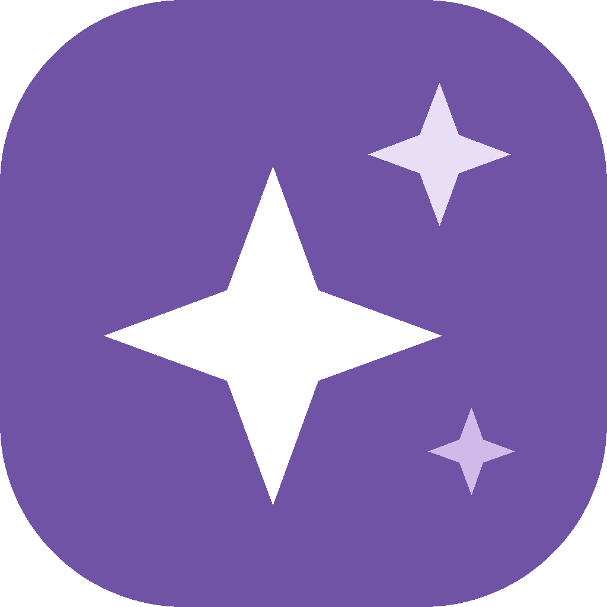
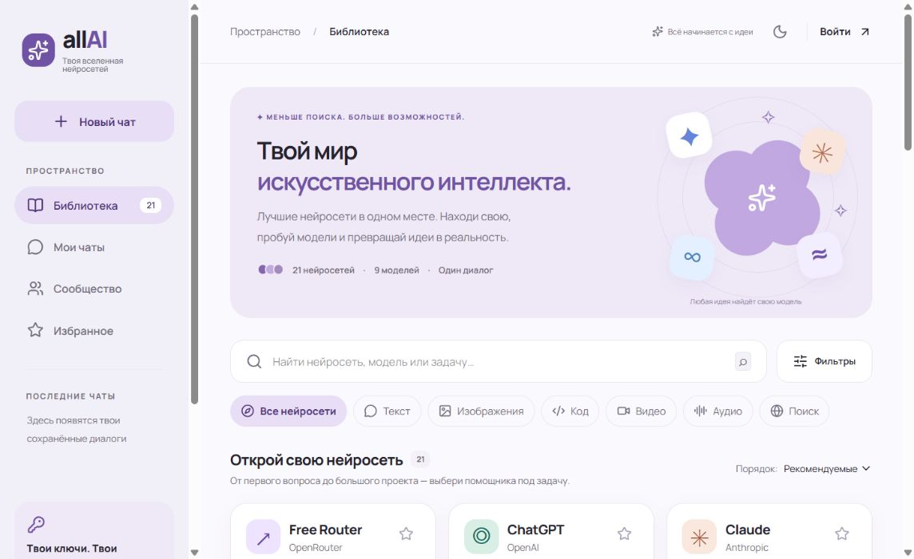

<p align="center">
  
</p>

<h1 align="center">allAI</h1>

<p align="center">Твоя библиотека нейросетей. Один чат — множество моделей.</p>

<p align="center">
  <a href="https://github.com/RTrueno/allAI/releases">Выпуски приложения</a> ·
  <a href="https://allai-library-ruslan.rainyhedgehog.chatgpt.site/">Веб-версия</a> ·
  <a href="desktop/README.md">Сборка и запуск</a>
</p>

allAI помогает находить нейросети и общаться с текстовыми моделями через OpenRouter. Выбирай подходящую модель, меняй её во время разговора и продолжай работу с сохранённой историей.



## Возможности

- Библиотека нейросетей с поиском, категориями и избранным.
- Чат с моделями OpenRouter и переключение моделей с передачей истории.
- Подключение собственного OpenRouter API key.
- Аккаунт, сохранение личных диалогов и общая комната сообщества.
- Интерфейс Material You со светлой и тёмной темами.
- Веб-версия и отдельный десктопный клиент.

## Скачать

| Система | Доступность |
| --- | --- |
| Windows x64 | Установщик `.exe` и Portable подготовлены. Готовый выпуск будет доступен в [Releases](https://github.com/RTrueno/allAI/releases). |
| macOS — Apple Silicon и Intel | Предусмотрена сборка `.dmg` и `.zip` через GitHub Actions. Готовые файлы нужно добавить в Releases после успешной сборки. |
| Linux x64 | Предусмотрена сборка `.AppImage` и `.deb` через GitHub Actions. Готовые файлы нужно добавить в Releases после успешной сборки. |

Windows-приложение собрано и проверено на запуск. Сборки пока без цифровой подписи. macOS/Linux ещё не проверены на целевых системах.

## Начало работы

1. Скачай и установи приложение либо запусти portable-версию.
2. Войди в аккаунт, которому доступен сайт allAI.
3. Открой настройки и добавь свой [OpenRouter API key](https://openrouter.ai/keys).
4. Создай новый чат, выбери модель и отправь сообщение.

Десктопный клиент подключается к опубликованному сайту: для него нужны интернет и доступ к серверу. Диалоги общие с веб-версией при входе в тот же аккаунт. Серверная версия сейчас приватная; установка приложения не открывает доступ новым пользователям автоматически.

Ключ хранится в памяти страницы и вводится повторно после её перезапуска. Платные модели расходуют баланс пользовательского ключа; бесплатные модели имеют лимиты провайдера. Встроенная оплата и прямые ключи отдельных провайдеров не подключены.

## Запуск из исходников

Нужен Node.js 22.13 или новее.

```sh
cd desktop
npm ci
npm start
```

Проверки клиента:

```sh
npm test
```

Сборки для своей ОС:

```sh
npm run dist:win
npm run dist:mac
npm run dist:linux
```

Для сборки всех платформ через GitHub открой **Actions → Desktop builds → Run workflow**. После завершения файлы появятся в **Artifacts**. Workflow должен быть загружен в `.github/workflows/desktop.yml` в основной ветке репозитория.

Инструкция по веб-приложению, базе и API: [README-ALLAI.md](docs/WEB.md).

## Технологии

**Desktop:** Electron, electron-builder. **Web:** React, TypeScript, Vinext. **Backend:** Cloudflare Workers, D1, официальный OpenRouter SDK.

## Обратная связь

Нашёл ошибку или придумал улучшение? [Создай issue](https://github.com/RTrueno/allAI/issues) и опиши шаги воспроизведения. Не прикладывай API-ключи, пароли и коды входа.
